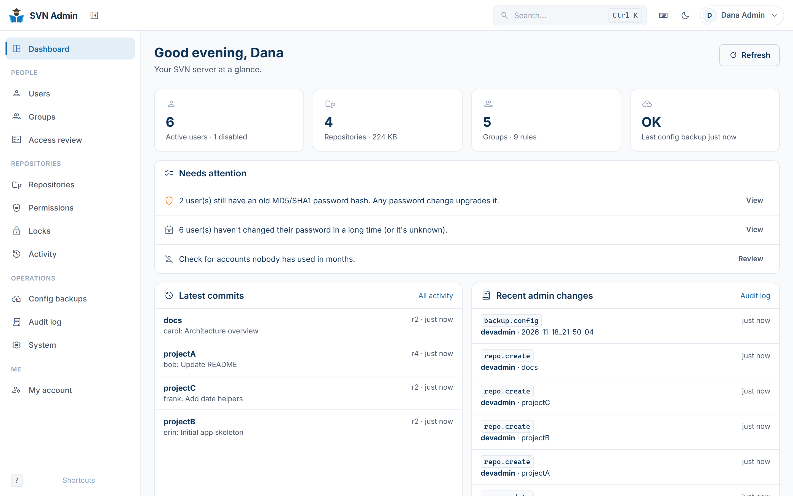
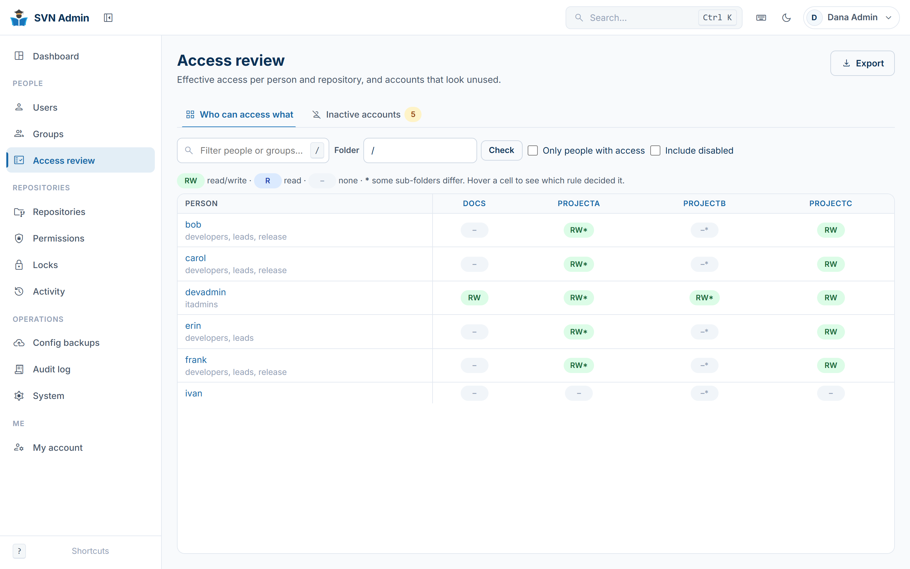
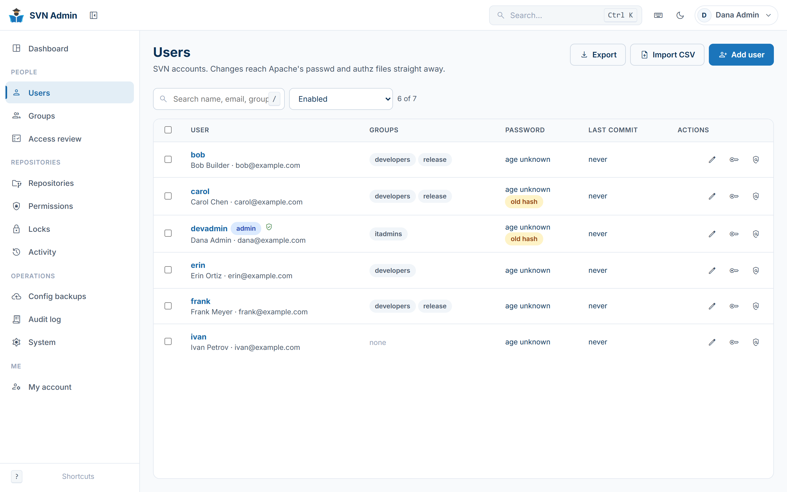
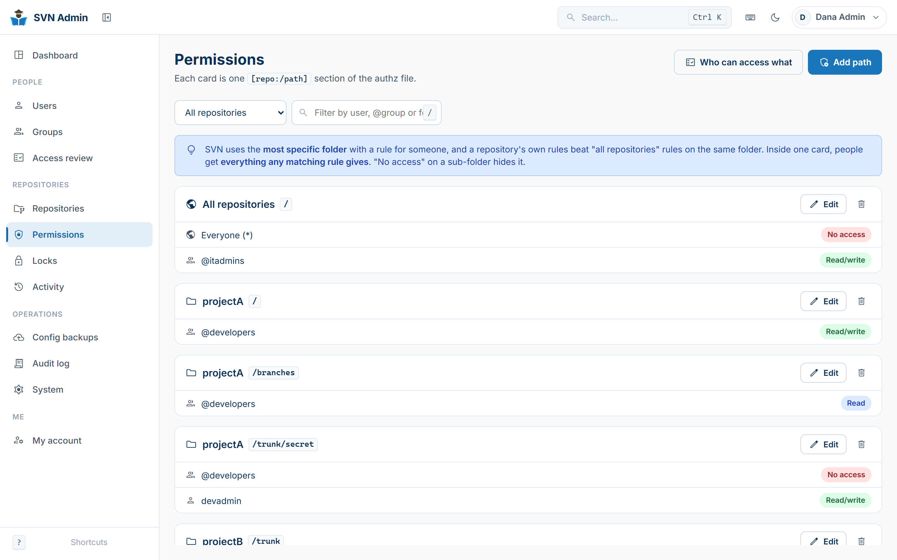
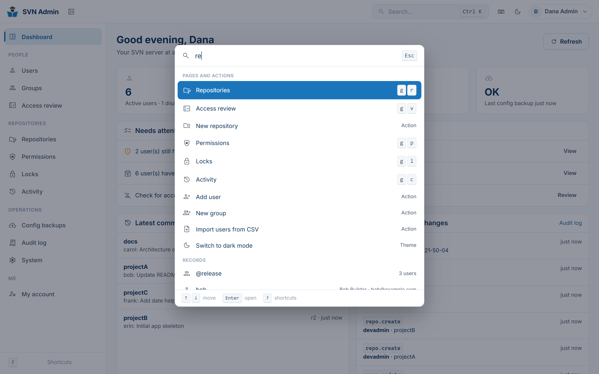
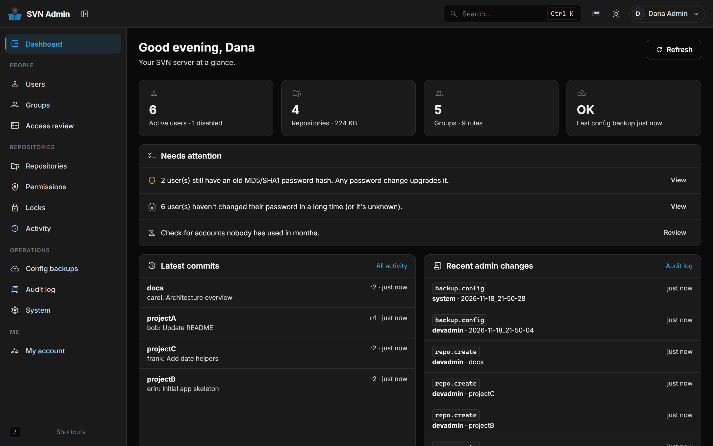
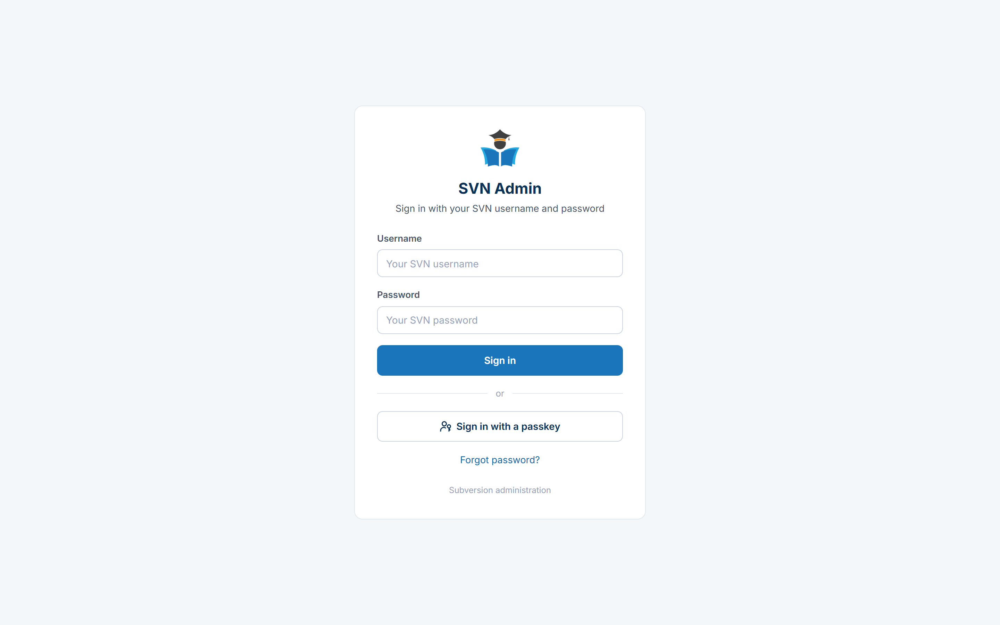

<p align="center"></p>

# SvnAdmin

**A modern web admin portal for Subversion servers.** Manage users, groups, repositories and folder permissions from
the browser instead of hand-editing `htpasswd` and `authz` files, with two-step sign-in, an audit log and an access
review that shows exactly what SVN will enforce.

SvnAdmin works with an existing **Apache httpd + mod_dav_svn** server that uses an `AuthUserFile` (htpasswd) and an
`AuthzSVNAccessFile`. Developers keep using TortoiseSVN or the `svn` command line exactly as before.



<table>
  <tr>
    <td><br><b>Access review:</b> who can open what</td>
    <td><br><b>Users</b> and group membership</td>
  </tr>
  <tr>
    <td><br><b>Folder permissions</b>, validated before saving</td>
    <td><br><b>Ctrl+K</b> finds any page, person or repository</td>
  </tr>
  <tr>
    <td><br><b>Dark mode</b></td>
    <td><br><b>Sign in</b> with a password, passkey or authenticator app</td>
  </tr>
</table>

Screenshots use sample data only.

## Features

**Administration**
- Users, groups (including nested `@groups`) and folder-level permissions, from the browser
- Create, archive and restore repositories, and browse recent commits
- One-step offboarding, bulk actions and CSV import
- Find and break stale file locks

**Visibility**
- **Access review:** who can read or write which repository and folder, exportable to CSV
- Inactive accounts report, a dashboard of what needs attention, and CSV export from every list
- **Audit log** of every change and sign-in, searchable by date and downloadable

**Security**
- Two-step sign-in with **passkeys** (WebAuthn) or an **authenticator app** (TOTP), plus recovery codes. Required for admins by default.
- Account lockout, rate limiting, idle session timeout, CSRF protection and a strict Content-Security-Policy
- Every authz change is validated before it is written, so a typo can't stop SVN for everyone

**Self-service**
- Developers sign in with their SVN username and password to change their password and see their own access
- "Forgot password" and welcome emails over any SMTP server (set up and tested from the System page)

**Reliability**
- Daily **config backups** (passwd, authz and the SvnAdmin database) with one-click restore
- Atomic file writes with full history; hand edits to the authz file are detected, never silently overwritten

**Ease of use**
- Light and dark mode, `Ctrl+K` global search and keyboard shortcuts, works on phones
- Ships with the Global Fin X logo and colours; set your own product name and logo with `Svn:ProductName` and `Svn:LogoFile`

## Requirements

- Windows Server or Windows 10/11 running Apache httpd with `mod_dav_svn` (the service host is Windows-only today)
- Subversion command-line tools (`svn`, `svnadmin`, `svnlook`) matching your `mod_dav_svn` version
- To build: .NET 10 SDK and Node.js 22+

## Quick start (local, with sample data)

```powershell
# terminal 1: API on http://localhost:5080 using dev-data\ (emails are written to dev-data\mail)
cd server\SvnAdmin.Api
dotnet run --no-launch-profile -- --environment Development

# terminal 2: UI with live reload on http://localhost:4200 (proxies /api to the API)
cd client
npm ci
npm start
```

Sign in with the sample accounts in [`dev-data/README.md`](dev-data/README.md). Use `localhost`, not `127.0.0.1`,
because passkeys don't work on IP addresses. Delete `dev-data/svnadmin.db*` to re-import from the sample files.

## Deploying

See [deploy/DEPLOY.md](deploy/DEPLOY.md). In short: `.\deploy\build.ps1` (tests run first), copy `publish\` to the
server, add an `appsettings.Local.json` (start from
[`deploy/appsettings.Local.example.json`](deploy/appsettings.Local.example.json)), run `install-service.ps1`, and
point an Apache VirtualHost at `127.0.0.1:5080` ([example](deploy/apache-svnadmin.conf)).

## How it works

SQLite is the source of truth. After every change SvnAdmin regenerates Apache's two files from it:

| File | Generated from |
|---|---|
| passwd (`AuthUserFile`) | enabled users and their bcrypt (`$2y$`) hashes |
| authz (`AuthzSVNAccessFile`) | groups (including nested `@groups`) and folder rules |

On first start it imports your existing passwd and authz files. All changes then go through one lock in
`Services/ConfigSync.cs`, which:
1. pulls in password changes made directly in the passwd file,
2. applies the change in a database transaction,
3. validates the authz (no undefined groups, no group cycles), since a bad file would block all SVN access,
4. writes both files atomically (temp file + rename), keeping the previous copy in `ConfigHistoryDir`,
5. refuses to write if someone hand-edited the authz file since the last save.

The **access review** works out effective access exactly the way Subversion does (`Svn/AccessEvaluator.cs`).
The rules were confirmed against a real `svnserve` 1.14 and are pinned by unit tests:
- the most specific folder with a rule for the user wins,
- on the same folder, the repository's own section beats the all-repositories section,
- within a section, the user gets the union of every matching rule.

## Security design

- Sign-in checks the password against the passwd hash (bcrypt, plus legacy `$apr1$` and `{SHA}`, upgraded on the next change).
- Admins (members of `Svn:AdminGroup`) must have two-step sign-in before any admin page works. Roles are re-checked on every request.
- Each TOTP code works only once, and TOTP secrets and the SMTP password are encrypted at rest with ASP.NET Data Protection.
- Email links store only a SHA-256 of the token, work once and expire. "Forgot password" never reveals whether an account exists.
- Cookies are `HttpOnly`, `SameSite=Strict` and `Secure` behind HTTPS. Every state-changing call needs the `X-XSRF-TOKEN` header.
- Fonts and icons are self-hosted; no CDNs. SVN tools are run with argument lists, never through a shell.

Found a vulnerability? Please follow [SECURITY.md](SECURITY.md) rather than opening a public issue.

## Tests

```powershell
cd server
dotnet test
```

- **Unit tests:** authz parsing and writing, the access evaluator (svnserve-verified cases), password hashes
  (bcrypt / APR1 / SHA vectors from openssl), TOTP, lock-output parsing, CSV import and validation.
- **API tests:** start the real app against a temp folder and cover sign-in, MFA enforcement, CSRF,
  blocking on hand-edited authz, group cycles, one-time reset links and email settings.

`deploy\build.ps1` runs them and stops if any fail, and the GitHub Actions workflow runs them on every push.

## Project layout

```
server/SvnAdmin.Api/      ASP.NET Core 10 minimal API + SQLite (Dapper); wwwroot is built from client/
  Data/Migrations/*.sql   schema, applied automatically on start
  Endpoints/              REST endpoints per area (auth, account, users, groups, access, repos, reports, admin)
  Services/               ConfigSync (file sync), RepoService, BackupService, ActivityScanner, AccountLinks, EmailSender
  Svn/                    passwd/authz parsing + rendering, AccessEvaluator, svn/svnadmin/svnlook runner
  Security/               hashes, sessions, TOTP + recovery codes, passkeys
server/SvnAdmin.Tests/    xUnit tests
client/                   Angular 21 app (standalone components, signals)
  src/styles/             design tokens (light/dark) and mx- components
  src/app/ui/             shell pieces: icon, command palette, shortcuts, password field, helpers
  src/app/pages/          one file per page
deploy/                   build.ps1, install-service.ps1, Apache config, example settings, DEPLOY.md
dev-data/                 sample passwd/authz for local testing
```

## Roadmap

- Linux support (systemd service and a Docker image)
- First-run setup wizard
- svnserve (`passwd` / `authz` without Apache) support

Contributions are welcome. See [CONTRIBUTING.md](CONTRIBUTING.md).

## License

[MIT](LICENSE)
